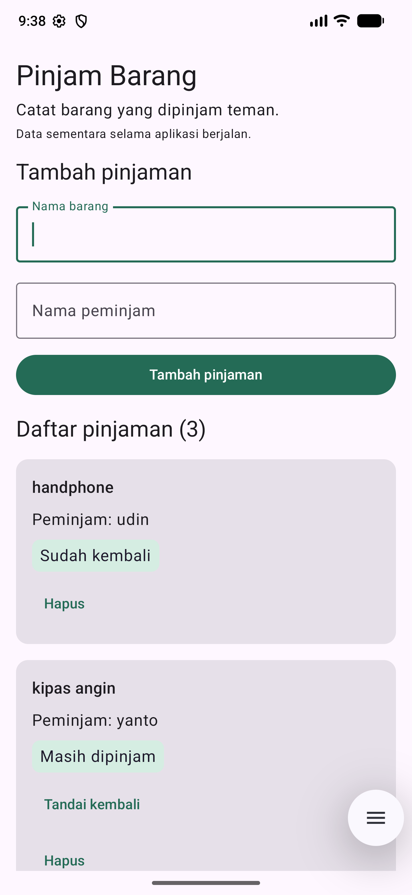
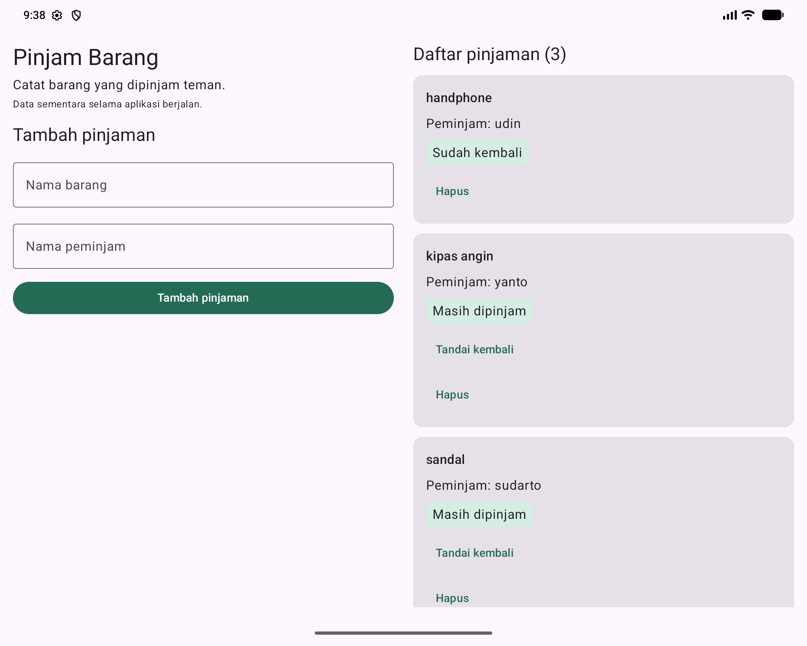

# Pinjam Barang

## Anggota kelompok

| Nama | NIM |
| --- | --- |
| Aditya Rizki Pratama | 24523098 |
| Muhammad Thaahir Ramadhan | 24523081 |

## Masalah

Mahasiswa sering lupa siapa yang meminjam barangnya dan apakah barang tersebut sudah dikembalikan.

## Pengguna sasaran

Mahasiswa atau penghuni kos yang meminjamkan barang kepada teman.

## Solusi

Aplikasi satu layar untuk mencatat nama barang, nama peminjam, dan status pengembalian. Data disimpan sementara di memori selama ViewModel masih hidup.

## Fitur

1. Menambah catatan peminjaman dengan validasi nama barang dan nama peminjam wajib diisi.
2. Menandai barang sudah dikembalikan.
3. Menghapus catatan peminjaman.

## Cara menjalankan

1. Clone repository:
   ```bash
   git clone https://github.com/V0ITS/PinjamDulu-PAB.git
   ```
2. Buka folder proyek di Android Studio yang mendukung Android Gradle Plugin 9.4.1.
3. Gunakan JDK 21 dan pasang Android SDK Platform 37 melalui SDK Manager.
4. Tunggu Gradle Sync selesai. Android Studio akan menyesuaikan lokasi SDK melalui `local.properties`.
5. Jalankan modul `app` pada emulator atau perangkat Android 7.0 (API 24) atau lebih baru.

## Kontribusi anggota

Pembagian tanggung jawab kelompok:

| Anggota | Tanggung jawab | Porsi |
| --- | --- | --- |
| Aditya Rizki Pratama | Menyiapkan proyek dan konfigurasi Gradle; membuat model data, UiState, dan ViewModel; menerapkan validasi, fitur tambah, pengembalian, dan hapus; menghubungkan StateFlow serta alur UDF; menguji logika aplikasi dan mengelola repository. | 70% |
| Muhammad Thaahir Ramadhan | Membuat tampilan formulir dan daftar dengan Compose; mengatur layout adaptif, label, dan pesan pada UI; memeriksa tampilan serta melengkapi README. | 30% |

## Contoh alur UDF

1. Pengguna mengisi nama barang **Payung** dan nama peminjam **Rina**.
2. Pengguna menekan **Tambah pinjaman**; callback UI memanggil `tambahPinjaman()` pada `PinjamViewModel`.
3. ViewModel memvalidasi input dan memperbarui `PinjamUiState` melalui `_uiState.update { ... }`.
4. `StateFlow` menyediakan state terbaru kepada UI.
5. `collectAsStateWithLifecycle()` mengamati perubahan, lalu Compose menampilkan catatan baru dan mengosongkan formulir.

## Screenshot dua ukuran layar

Screenshot diambil dari aplikasi yang berjalan pada emulator Pixel_6_Pro. Untuk tampilan lebar, ukuran dan density emulator diubah sementara, lalu dikembalikan ke pengaturan semula.

### Layar ponsel — satu kolom

1440 × 3120 px pada 560 dpi (sekitar 411 × 891 dp). Formulir dan daftar berada dalam satu area scroll.



### Layar lebar — dua panel

2000 × 1600 px pada 320 dpi (1000 × 800 dp). Formulir berada di kiri dan daftar pinjaman di kanan. Dua panel digunakan ketika lebar jendela minimal 840 dp dan tinggi minimal 480 dp.



## Slide presentasi

[Unduh slide presentasi (PDF, 5 halaman)](Slide-Pinjam-Barang.pdf)

Isi slide: masalah dan pengguna, solusi dan fitur, MVVM dan contoh UDF, screenshot dua ukuran layar, serta cara menjalankan dan kontribusi anggota.

## Referensi

- Materi M11: UI/UX dan Adaptive Layout Compose.
- Materi M12: MVVM dan ViewModel Jetpack Compose.
- Materi M13: UI State, StateFlow, dan Unidirectional Data Flow.
- [State pada Jetpack Compose](https://developer.android.com/develop/ui/compose/state)
- [ViewModel](https://developer.android.com/topic/libraries/architecture/viewmodel)
- [Layout adaptif](https://developer.android.com/develop/ui/compose/layouts/adaptive)
